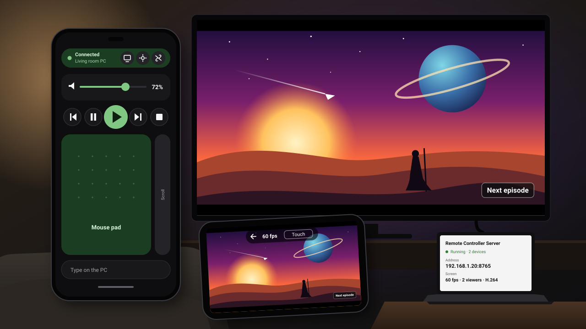
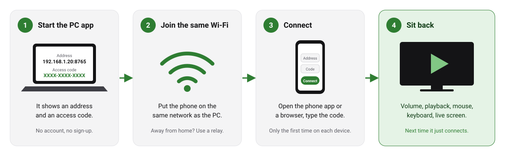
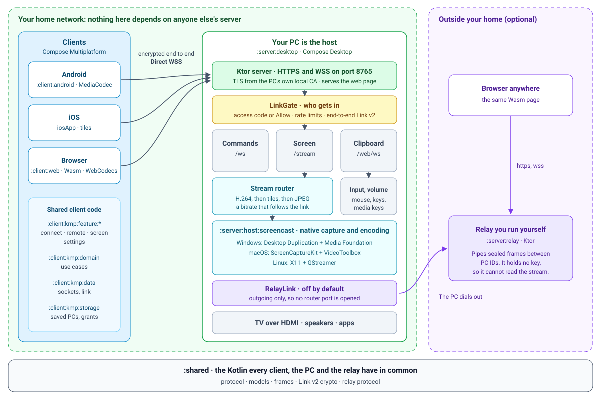

# Remote Controller

**Your PC is the TV. Your phone is the remote. Nobody else sits in between.**


[](LICENSE)



An open source **Compose Multiplatform** project: one Kotlin codebase that runs on every device you own, with **low CPU load**, **minimal delay** and **no account**.

## The problem

You plug your laptop into the TV, start a film and sit down on the couch. Then the sound is too quiet. Then **Next episode** needs a click. So you get up again.

The TV remote cannot reach the laptop. Remote desktop tools can, but they were built for IT support: they bring a company's servers, and often an account, just to turn the volume up.

Remote Controller turns the phone already in your hand into that missing remote. Nothing to sign up for, and no one else's server in the way.

## What you get

| | |
|---|---|
| **Remote** | Volume, mute, play, pause, next, previous, stop |
| **Mouse pad** | Move, click, drag and scroll with your fingers |
| **Keyboard** | Type in any language, or capture every key in the browser |
| **Live screen** | Watch and control your PC from a phone or a browser |
| **Clipboard** | Share text and images between a browser and the PC |
| **From anywhere** | Reach your PC through a relay you run yourself |

## Runs on everything

| | |
|---|---|
| **Your PC** | Windows x64, macOS on Apple Silicon, Linux x64 on X11 |
| **Control it from** | Android, iOS, or any modern browser with nothing to install |

Get the PC app and the Android app from [Releases](https://github.com/kremlev404/remote-controller/releases). iOS builds from Xcode.

## Light and fast

The video comes from your GPU's hardware encoder, so CPU load stays low. It travels straight over your Wi-Fi with no trip to the cloud, which keeps the delay down. A still screen sends nothing at all.

| 1080p to a phone over Wi-Fi | Frame rate | CPU, one core |
|---|---|---|
| Live video | **60 fps** | **17%** |
| Still screen | 0 fps | under 1% |
| The old JPEG stream, at 720p | 19 fps | 61% |

Measured on Windows with a Ryzen 5 3600 and an RTX 3060. macOS is not measured yet.

No H.264 on one side? The stream drops to **Tiles**, which sends only what changed on screen and held 60 fps at 1080p in testing. You can pick H.264, Tiles or JPEG in the PC app. See [how streaming works](docs/streaming.md).

## Why not TeamViewer?

**There is no host to trust, because you are the host.** At home your devices talk straight to your own PC, with end-to-end encryption. There is no account to steal, no company server to breach, and no outage in someone else's data centre.

| | Remote Controller | TeamViewer | AnyDesk | RustDesk | Chrome Remote Desktop |
|---|---|---|---|---|---|
| **Who runs the servers** | **You: it's your PC** | TeamViewer | AnyDesk, or you on paid Enterprise | RustDesk, or you | Google |
| **A company's server on a home connection** | **No** | Yes | Yes | By default | Yes |
| **Account** | **None** | For managed devices | Optional | None | Google account |
| **Source code** | **Open, Apache 2.0** | Closed | Closed | Open, AGPL | Closed |

The others encrypt their sessions too. The difference is who you have to trust. Compared in November 2026, so check their sites for changes. Our limits are listed in [the security notes](docs/security.md).

## How to use it



- **In a browser:** open `https://<address>/web`. Press **Trust this computer** in the PC app first to avoid a certificate warning.
- **Without a code:** turn off **Require access code**, then press **Allow** on the PC when a device asks.
- **Away from home:** [run your own relay](docs/relay.md), then open it in a browser from anywhere.

More in the [user guide](docs/using.md).

## Build from source

```bash
./gradlew :desktop:run             # PC app, with the web page bundled
./gradlew :android:assembleDebug   # Android
./gradlew packageDesktop           # portable app for this OS
```

For iOS, open `iosApp` in Xcode.

## Documentation

| | |
|---|---|
| [User guide](docs/using.md) | Access codes, touch gestures, keyboard capture, the web page |
| [Streaming](docs/streaming.md) | Capture, encoding, stream types, measurements |
| [Security](docs/security.md) | TLS, admission, end-to-end encryption, what is still on you |
| [Relay](docs/relay.md) | Reaching your PC from anywhere, deployment |
| [Building](docs/building.md) | Requirements, CI, releases, Linux notes, modules |
| [Research](docs/research/README.md) | Experiments and their numbers |

## License

Apache License 2.0. See [LICENSE](LICENSE) and [NOTICE](NOTICE).

## Architecture



Your PC runs the server, and phones and browsers connect straight to it. A browser outside your network goes through a relay you host, which the PC dials out to, so your router needs no open port.
