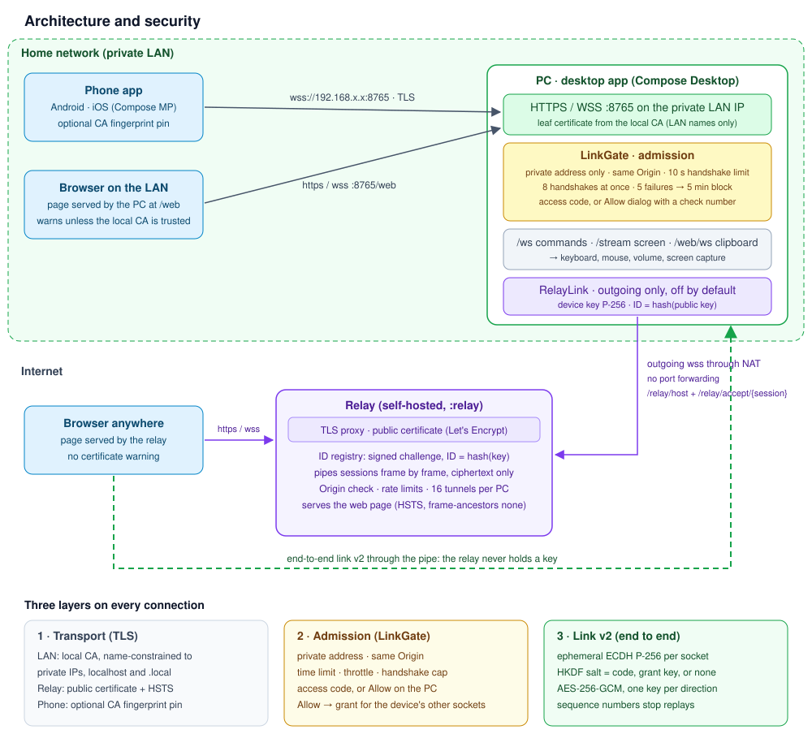
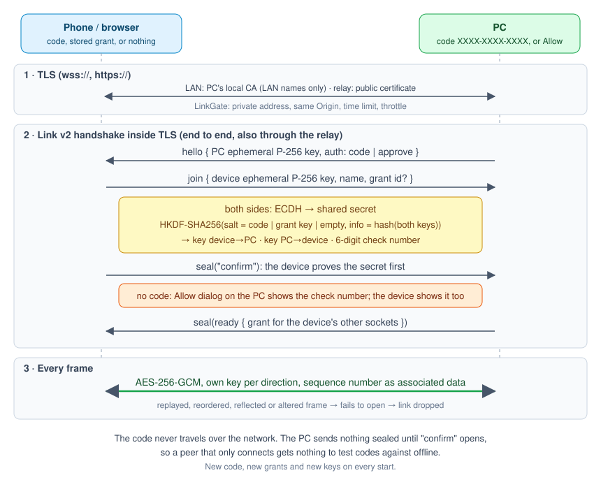

# Remote Controller

**The laptop is the TV. The phone is the remote.**

The laptop is plugged into the TV over HDMI, and you are on the couch. Remote Controller puts volume, playback, a mouse pad and a keyboard on your phone or in any browser. It is free, needs no account, and has no cloud in the middle. To reach the laptop from outside the home network, you can run your own relay.


| From the couch | On the laptop |
|---|---|
| Volume, mute | System volume |
| Play, pause, next, previous | Media keys |
| Move, click, scroll | The pointer: hit **Skip** and **Next episode** |
| Arrows, Enter, Escape, F-keys | Keyboard |
| Browser page | Screen view and a shared clipboard |

## Use it

1. Start the laptop app. It shows an **address** (e.g. `192.168.1.20:8765`) and, with **Require access code** on, an **access code** (`XXXX-XXXX-XXXX`). A new code is made on every start.
2. Put the phone on the same Wi-Fi (guest networks that isolate devices will not work), or turn on **Reach from anywhere** (below).
3. Connect from the phone app or from a browser.

The text row under the mouse pad and on the screen view types on the laptop as you type, in any language. Send on the keyboard presses Enter.

On the phone's screen view a finger works like a laptop touchpad: drag to move, tap to click, double tap and hold to drag, two fingers to right click (tap) or scroll (drag). **Touch** switches to pressing right where you touch.

**Require access code** (on by default) decides how a device gets in:

| Switch | What the device does | What the laptop does |
|---|---|---|
| On | types the code | nothing |
| Off | connects and shows a six-digit check number | pops up **Allow / Deny** with the same number |

An allowed device gets a grant for its other sockets (screen, clipboard), so it asks once. **Disconnect** on the laptop forgets that device. Turning the code back on drops every allowed device. Grants live in memory only, so restarting the app forgets them too.

## Architecture



The laptop runs the server. Phones and LAN browsers connect to it directly. A browser outside the LAN goes through a self-hosted **relay**. The laptop dials out to the relay, so the router needs no open port.

## Security

Every connection passes three layers:

1. **TLS.** On the LAN, the laptop's own CA issues the server certificate. That CA has critical name constraints: it covers private IPv4 ranges, `localhost` and `.local`, and nothing else, so trusting it cannot expose public sites. The relay uses a public certificate with HSTS. The phone can pin the CA's SHA-256 fingerprint (**Certificate** switch on both sides).
2. **Admission (LinkGate).** Checks run before any key exchange:
   - LAN peers must come from a private address.
   - A browser socket must come from the page's own Origin.
   - The handshake must finish within 10 seconds.
   - At most 8 handshakes run at once.
   - 5 failures in a minute block that address for 5 minutes.
3. **Link v2, end to end.** It also runs through the relay, so the relay never holds a key.



- Each socket uses ephemeral P-256 ECDH. HKDF-SHA256 uses the access code, a grant key, or nothing (when the laptop asks its owner) as salt, and a hash of both public keys as info.
- The device proves the secret first (`confirm`). Until then the laptop sends nothing sealed, so connecting gives an attacker nothing to test codes against offline.
- Each direction has its own AES-256-GCM key, and a sequence number goes into the associated data. A replayed, reordered, reflected or altered frame fails to open, and the link drops.
- Both sides derive the same six-digit check number. The Allow dialog shows it so you can spot a man in the middle.
- The `/web` page sends `nosniff`, `frame-ancestors 'none'`, `no-referrer`, COOP and Permissions-Policy headers.

What is still on you:
- With the code off, compare the check number before you press Allow.
- The relay serves the browser page's JavaScript, so run it yourself or trust whoever does.
- The code check is not a PAKE (password-authenticated key exchange, e.g. the SRP that TeamViewer uses). If a browser clicks through a certificate warning, a man in the middle can still get one chance to test codes offline.

## Web client

The browser page is a Compose for Web (Wasm) app. Both the laptop (at `/web`) and the relay (at `/`) serve the same build.

**On the LAN**
1. On the laptop, press **Trust this computer** once. On macOS it adds the local CA to the login keychain; on Windows it opens `local-ca.crt` to install.
2. Open `https://<address>/web`. To skip typing the code, add it as a fragment: `https://<address>/web#XXXX-XXXX-XXXX`. The page removes the fragment from the address bar and history.
   Devices that do not trust the CA show a certificate warning; install `local-ca.crt` there or accept the warning.
3. Type the code if the laptop asks for one; otherwise wait for **Allow**.

**From anywhere**: open `https://<relay>/#id=123456789`, or enter the laptop's ID on the relay's start page. No certificate warning, because the relay has a public certificate.

The CA, the relay device key (`relay-device.p8`) and their files live in `~/Library/Application Support/Remote Controller` (macOS), `%APPDATA%\Remote Controller` (Windows) or `~/.local/share/remote-controller` (Linux). The open button on the laptop's clipboard card opens the local page, with the code filled in when the code is required.

> Upgrading from an older version: the app makes a new, name-constrained CA. Remove the old **Remote Controller Local CA** from the keychain or certificate store, press **Trust this computer** again, and paste the new fingerprint into phones that pin it.

## Reach from anywhere (relay)

This works like TeamViewer or RustDesk:
- The laptop keeps one **outgoing** websocket to a relay and signs the relay's challenge with its device key. Its **9-digit ID** is derived from that key, so nobody else can register the same ID.
- When a browser asks for the ID, the relay tells the laptop. The laptop opens a second outgoing socket for that session, and the relay pipes the two frame by frame.
- The relay checks Origin, rate-limits per address, and caps each laptop at 16 tunnels.

### Deploy the relay

You need a server with a public IP, a domain whose DNS A/AAAA record points at it, and ports 80 and 443 open. [`relay/deploy/deploy.sh`](relay/deploy/deploy.sh) builds the relay on your machine and installs it in one of two ways:

| Mode | What runs on the server | Certificate |
|---|---|---|
| `docker` | relay + [Caddy](relay/deploy/Caddyfile) with Docker Compose | Caddy gets and renews it |
| `systemd` | relay as a hardened [systemd service](relay/deploy/systemd/remote-controller-relay.service) behind [nginx](relay/deploy/nginx/relay.conf) | certbot gets it; its timer renews it |

```bash
# Docker on the server (needs Docker with the compose plugin there)
./relay/deploy/deploy.sh docker --domain relay.example.com --host root@203.0.113.10

# systemd + nginx on Debian, Ubuntu or Fedora (needs sudo there; installs Java 21, nginx, certbot)
./relay/deploy/deploy.sh systemd --domain relay.example.com --host admin@203.0.113.10 --email you@example.com

# Docker on this machine, or only the bundle to copy anywhere yourself
./relay/deploy/deploy.sh docker --domain relay.example.com
./relay/deploy/deploy.sh bundle --domain relay.example.com     # → relay/build/deploy
```

The bundle in `relay/build/deploy` holds the built relay, the [Dockerfile](relay/deploy/Dockerfile) (runtime only, non-root), [docker-compose.yml](relay/deploy/docker-compose.yml) and `.env`, and the nginx and systemd files with the domain filled in. Add `--skip-build` to reuse the last build.

What each setup locks down:
- **Relay process.** In Docker it is read-only, drops all capabilities, sets `no-new-privileges` and is capped at 512 MB. Under systemd it uses `DynamicUser`, `ProtectSystem=strict`, `ProtectHome`, no capabilities, and listens on `127.0.0.1` only.
- **nginx.** TLS 1.2/1.3 only. It **overwrites** `X-Forwarded-For` with the client address instead of appending to it, so clients cannot dodge the relay's rate limits. Websockets get a one-hour timeout.

Relay environment:

| Variable | Default | Meaning |
|---|---|---|
| `RELAY_ORIGIN` | none | Public origin, e.g. `https://relay.example.com`. Browsers from any other origin are refused. |
| `RELAY_TRUST_PROXY` | `false` | Read the client address from `X-Forwarded-For`. Only behind your own proxy. |
| `HOST`, `PORT` | `0.0.0.0`, `8080` | Listener |

Logs: `docker compose logs -f` in the bundle folder, or `journalctl -u remote-controller-relay -f`. Health check: `https://relay.example.com/healthz`.

On the laptop, turn on **Reach from anywhere**, enter `https://relay.example.com` and press **Save**. The card then shows the ID and the link to open.

Not done yet:
- The phone apps connect over the LAN only.
- All relay traffic goes through the relay. Direct peer-to-peer (WebRTC with STUN/TURN, TeamViewer's UDP hole punching) would take load off it.

## Build

```bash
./gradlew :desktop:run                  # laptop app; builds :web first and bundles it
./gradlew packageDesktop                # portable app for the host OS in artifacts/desktop
./scripts/build-linux.sh                # Linux: checks the tools, then the same as packageDesktop
./gradlew :web:wasmJsBrowserDistribution  # web page only → web/build/dist/wasmJs/productionExecutable
./gradlew :relay:installDist              # relay server; bundles the web page too
./gradlew :android:assembleDebug        # Android
```

iOS: open `iosApp` in Xcode (builds the `ClientUI` framework from `:client:feature:common`).

`:desktop:processResources` and `:relay:processResources` depend on `:web:wasmJsBrowserDistribution` and copy its output into the `web` resource folder, so both always ship the current page. Packaging needs a full JDK with `jpackage` (set `JAVA_HOME` or `DESKTOP_JDK_HOME`); on macOS also CMake for the volume library.

### CI and releases

There is one workflow: [.github/workflows/ci.yml](.github/workflows/ci.yml). Releases need no tags.

1. Open a pull request from a branch into `main`. **Lint** runs.
2. After lint passes, the same run stops at **Release approval**. To release, open the run and press **Review deployments → Approve**. To skip, ignore it: new pushes to the pull request replace the waiting run.
3. After approval these jobs run, and **Publish GitHub release** goes last, only if all of them pass.

On Windows and Linux the desktop file is portable: unpack and run, nothing to install. macOS gets a `.dmg`. Each carries its own Java runtime.

| Job | Builds | Release files |
|---|---|---|
| Desktop · Windows x64 | portable app | `remote-controller-server-<v>-windows-x64.zip` |
| Desktop · macOS arm64 | `.dmg` (Apple Silicon) | `remote-controller-server-<v>-macos-arm64.dmg` |
| Desktop · Linux x64 | portable app | `remote-controller-server-<v>-linux-x64.tar.xz` |
| Android · release APK | signed `assembleRelease`, signature checked | `remote-controller-<v>.apk` |
| **Publish GitHub release** | release `v<version>`, with the tag created on the pull request's head commit | everything, plus `SHA256SUMS.txt` |

**Running them:**

| OS | Steps |
|---|---|
| Windows | unzip, run `Remote Controller Server\Remote Controller Server.exe` |
| macOS | open the `.dmg`, drag the app to Applications (or start it straight from the image) |
| Linux (Ubuntu, Kali, Arch) | `tar -xJf remote-controller-server-*-linux-x64.tar.xz`, run `Remote Controller Server/bin/Remote Controller Server` |

**Size.** The app no longer ships the 36 MB Material icons library: `DesktopIcons` keeps the 15 icons it uses. It also drops Netty's QUIC/HTTP3 native libraries (~11 MB), since the server speaks HTTP/1.1 only. Linux uses `xz -9e`, about 12% smaller than gzip. Measured on the macOS app: one compressed copy went from 147 MB to about 90 MB. The old Linux release had four copies per CPU (.deb, .rpm, .tar.gz, Arch), about 600 MB in all, and now has one.

**ProGuard.** Release builds (`packageDesktop`, `createReleaseDistributable`) run the jars through ProGuard, shrinking only: no renaming, no optimization. The rules are in [desktop/proguard-rules.pro](desktop/proguard-rules.pro). Libraries that load classes by name are kept whole (Ktor, Netty, BouncyCastle, JNA, OkHttp, SLF4J, cryptography-kotlin), and Compose and the rest are shrunk.

If the release app fails where `./gradlew :desktop:run` works:
1. Build it without ProGuard: `./gradlew :desktop:packageDesktop -Pdesktop.proguard=false`.
2. If that build works, add a `-keep` rule for the class named in the error.

`./gradlew :desktop:runReleaseDistributable` starts the shrunk app directly.

**macOS.** The app is built for Apple Silicon only, on GitHub's `macos-15` runners. Intel Macs are not covered by the release. It is not signed with an Apple Developer ID. On first launch, macOS blocks it, and the user allows it once in **System Settings → Privacy & Security → Open Anyway**. Removing that step needs a paid Apple Developer account, signing and notarization.

**Version.** It is `version` in `version.properties`. If `v<version>` already exists, the run stops before building, so bump `version` and `versionCode` in the pull request first.

**Without a pull request.** Use **Actions → CI → Run workflow**, pick a branch, and it runs lint and then the release with no approval step.

**One-time setup** (repository Settings):
- **Environments → New environment `release` → Required reviewers:** add yourself. The approval job checks this rule and refuses to release without it, so a missing setting cannot release every pull request. Private repositories on the Free plan cannot add reviewers to an environment; use **Run workflow** there.
- **Secrets and variables → Actions:** add the APK signing secrets below. `scripts/local/make-android-signing.sh --gh` creates and uploads them. That script stays local: `scripts/local/` is git-ignored.
- **Branch protection:** if you use it, make only **Lint** required, so an unapproved release does not block merging.

| Secret | Value |
|---|---|
| `ANDROID_KEYSTORE_BASE64` | `base64 -i release.jks` |
| `ANDROID_KEYSTORE_PASSWORD`, `ANDROID_KEY_ALIAS`, `ANDROID_KEY_PASSWORD` | keystore password, key alias, key password |

For a local signed build, set the same names as environment variables or in `~/.gradle/gradle.properties`, with `ANDROID_KEYSTORE_FILE` pointing at the `.jks` (the script's `--local` does this). Without them `assembleRelease` builds an unsigned APK.

### Linux

The release ships one portable `.tar.xz` for x64. ARM Linux is not covered by the release. It runs on **Ubuntu (22.04 and newer), Kali and Arch**. It brings its own Java runtime, so nothing has to be installed:

```bash
tar -xJf remote-controller-server-<version>-linux-x64.tar.xz
"./Remote Controller Server/bin/Remote Controller Server"
```

**Building.** `./scripts/build-linux.sh` checks the tools, then runs `packageDesktop`. It needs:
- Linux, because jpackage builds only for the OS and CPU it runs on
- a full JDK 21 with `jpackage`
- `xz`

Build on the oldest distribution you support, because newer glibc is fine and older is not. CI builds on Ubuntu 22.04.

**At runtime:**

| Feature | Uses |
|---|---|
| Volume | `wpctl` (PipeWire), `pactl` (PulseAudio) or `amixer` (ALSA), whichever exists |
| Play, pause, next, previous | `playerctl` (install it; any MPRIS player works) |
| Start at login | `~/.config/autostart` |
| **Trust this computer** | adds the CA to `~/.pki/nssdb` for Chromium browsers (needs `certutil` from `libnss3-tools` / `nss-tools`); import `local-ca.crt` into Firefox yourself |
| Firewall | with firewalld running (Fedora), the window shows the port command and **Allow again** asks through `pkexec` |
| App folder | `~/.local/share/remote-controller` |

Mouse, keyboard and screen sharing go through Java's AWT Robot. They need an **X11 session**: on GNOME or KDE with Wayland, choose "Xorg" or "Plasma (X11)" at login. Install `xdotool` to type more than plain Latin letters from the phone.

## Modules

| Module | What it is |
|---|---|
| `:desktop` | Laptop app and server (Ktor, TLS, LinkGate, approvals, relay link, input, volume, screen) |
| `:web` | Browser client (Kotlin/Wasm), served at `/web` and by the relay |
| `:relay` | Self-hosted rendezvous relay (Ktor): PC IDs, session pipes |
| `:android`, `iosApp` | Phone apps |
| `:client:feature:*` | Phone screens (`api` route + `impl` screen), `common` shell, `umbrella` wiring |
| `:client:core` | Shared route contract |
| `:client:domain`, `:client:data`, `:client:storage` | Use cases, socket, saved servers |
| `:shared` | Protocol, models, link crypto (v2), relay protocol |
| `build-logic` | Gradle convention plugins |

Product name and version: `version.properties`.
