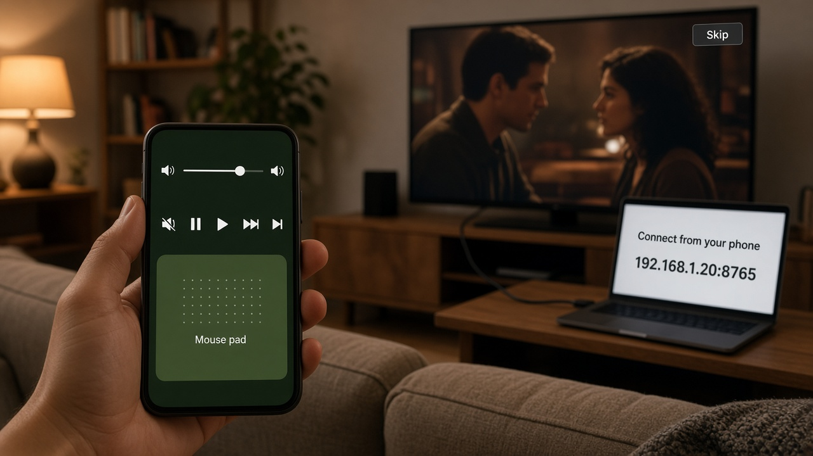

# Remote Controller

**The laptop is the TV. The phone is the remote.**

You already have a laptop plugged into the television with an HDMI cable. The picture is on the screen. You are on the couch, and the laptop is two to ten meters away. Standing up to skip an ad, lower the volume, or start the next episode is the whole problem.

Remote Controller is that remote. It is free now, and it stays free.



## Stay seated

The phone does not stream the movie. The laptop does. The phone only reaches across the room and presses what you would have pressed.

| From the couch | On the laptop |
|---|---|
| Volume, including mute | The system volume |
| Play, pause, next, previous | The media keys your player already understands |
| Move, click, scroll | The pointer. That is how you hit **Skip** and **Next episode** |
| Arrows, Enter, Escape, function keys | A keyboard, when the player wants one |

The address you type the first time is saved. Next evening you open the phone and you are back.

## Three things in the room

1. **The TV** only receives HDMI. It does not need apps, an account, or a smart-TV remote.
2. **The laptop** runs this app and shows an address, for example `192.168.1.20:8765`. Leave it running. It can start when the laptop starts.
3. **The phone** joins the same Wi-Fi, uses that address, and stays in your hand.

Nothing else is required. There is no account to create and no service of ours in the middle. The phone talks to the laptop. The laptop talks to the TV through the cable you already own.

## Free, and staying that way

This is a remote control for a computer on your own network. There is no subscription to lapse, no viewing history to collect, and no cloud account that would make a paid tier possible later. If the laptop and the phone can see each other on Wi-Fi, it works. That is the whole product, and it remains free.

## Download the laptop app

macOS and Windows builds are published by GitLab CI.

- Push a version tag. The pipeline builds the installer on a Mac and on a Windows machine, and GitLab turns that tag into a Release with both downloads.
- You can also download `artifacts/desktop` from the `macos` or `windows` job on that pipeline before the Release is created.

Each build contains the installer and a portable copy of the app. The phone apps for Android and iOS are in this repository. They are not in the stores yet.

The Mac that builds the macOS app needs a runner tagged `macos`, with a full JDK that includes `jpackage` and with CMake. The Windows machine needs a runner tagged `windows` and a JDK with `jpackage`. Android Studio's bundled runtime is not enough. Point the runner at a normal JDK with `JAVA_HOME` or `DESKTOP_JDK_HOME`.

## Use it

1. Plug the laptop into the TV with HDMI and set the TV to that input.
2. Open the laptop app. Read the address on the screen.
3. On the phone, connect to that address. Same Wi-Fi, not mobile data.
4. Sit down. Volume, next, and a click on the screen are in your hand.

A guest Wi-Fi that hides devices from each other will not connect. Use the network where the laptop and the phone can see each other.

## What it will not do

It will not turn the television into a smart TV, and it will not install anything on the TV. It will not remove ads from a stream. It gives you the click and the keys, so the Skip button and the next-episode button are reachable without crossing the room.

## Build from source

Laptop app, from the repository root:

```bash
./gradlew :desktop:run
./gradlew packageDesktop
```

`packageDesktop` writes the installer and a portable app into `artifacts/desktop`. On macOS the volume control is a small native library built with CMake during that build.

Phone:

```bash
./gradlew :android:assembleDebug
```

The iOS app is the `iosApp` Xcode project. It builds the `ClientUI` framework from `:client:feature:common`.

| Module | What it is |
|---|---|
| `:desktop` | Laptop app. The window, the address, volume, keyboard, and mouse |
| `:android`, `iosApp` | Phone apps |
| `:client:feature:connect` | Connect screen. `api` is the route, `impl` is the screen |
| `:client:feature:remote` | Remote screen, same split |
| `:client:feature:umbrella` | Holds the screen implementations and their dependencies |
| `:client:feature:common` | Shared phone shell: theme, navigation, app graph |
| `:client:core` | Route contract the screens share |
| `:client:domain`, `:client:data` | Use cases, and the socket that reaches the laptop |
| `:shared` | Messages both sides understand |
| `build-logic` | Shared Gradle setup |

Gradle conventions live in `build-logic` (`remotecontroller.kmp.library`, `remotecontroller.kmp.compose`, `remotecontroller.kmp.feature.api`, `remotecontroller.kmp.feature.impl`, `remotecontroller.android.application`). Product name and version for installers live in `version.properties`.
