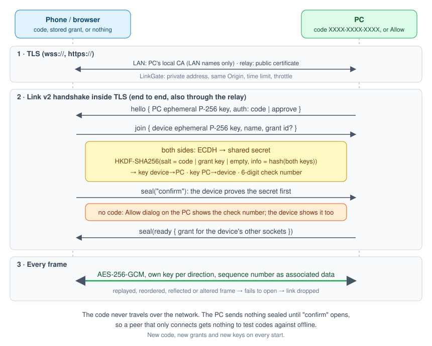

# Security

Every connection passes three layers:

1. **TLS.** On the LAN, the laptop's own CA issues the server certificate. That CA has critical name constraints: it covers private IPv4 ranges, `localhost` and `.local`, and nothing else, so trusting it cannot expose public sites. The relay uses a public certificate with HSTS. The phone can pin the CA's SHA-256 fingerprint (**Certificate** switch on both sides).
2. **Admission (LinkGate).** Checks run before any key exchange:
   - LAN peers must come from a private address.
   - A browser socket must come from the page's own Origin.
   - The handshake must finish within 10 seconds.
   - At most 8 handshakes run at once.
   - 5 failures in a minute block that address for 5 minutes.
3. **Link v2, end to end.** It also runs through the relay, so the relay never holds a key.

- Each socket uses ephemeral P-256 ECDH. HKDF-SHA256 uses the access code, a grant key, or nothing (when the laptop asks its owner) as salt, and a hash of both public keys as info.
- A grant is a 256-bit key behind a random id. Only the id goes on the socket, and the grant is valid with the code on or off, so anyone who copies it from a device can get in until it is forgotten.
- The device proves the secret first (`confirm`). Until then the laptop sends nothing sealed, so connecting gives an attacker nothing to test codes against offline.
- Each direction has its own AES-256-GCM key, and a sequence number goes into the associated data. A replayed, reordered, reflected or altered frame fails to open, and the link drops.
- Both sides derive the same six-digit check number. The Allow dialog shows it so you can spot a man in the middle.
- The `/web` page sends `nosniff`, `frame-ancestors 'none'`, `no-referrer`, COOP and Permissions-Policy headers.
- Video travels sealed like every other frame, so a decoder only ever sees bytes from the paired PC. The codec list and keyframe requests are sealed too. A frame that does not open ends the stream, and keyframe requests are rate-limited, so a viewer cannot keep the GPU busy.
- `screencast.dll` sits in the app's own folder and loads by full path, never from a temp folder or the search path. Its imports load from System32 only. It builds with Control Flow Guard, CET, ASLR and DEP, and it never parses data from the network: it only produces video.

What is still on you:
- With the code off, compare the check number before you press Allow.
- The relay serves the browser page's JavaScript, so run it yourself or trust whoever does.
- The code check is not a PAKE (password-authenticated key exchange, e.g. the SRP that TeamViewer uses). If a browser clicks through a certificate warning, a man in the middle can still get one chance to test codes offline.
